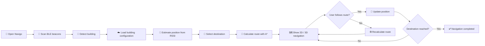
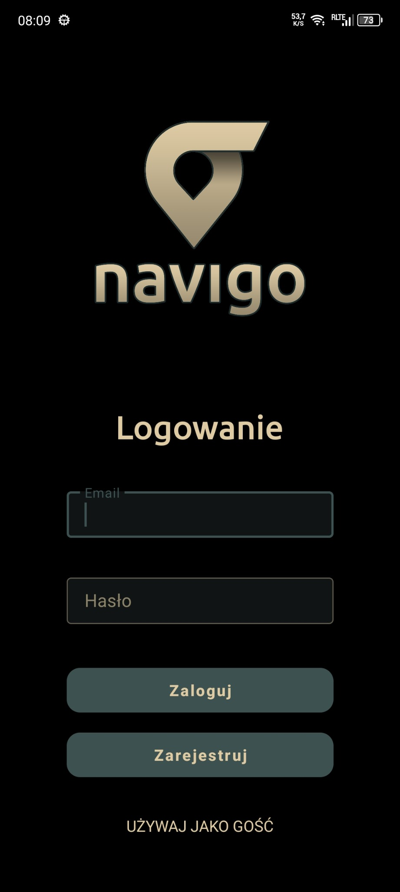
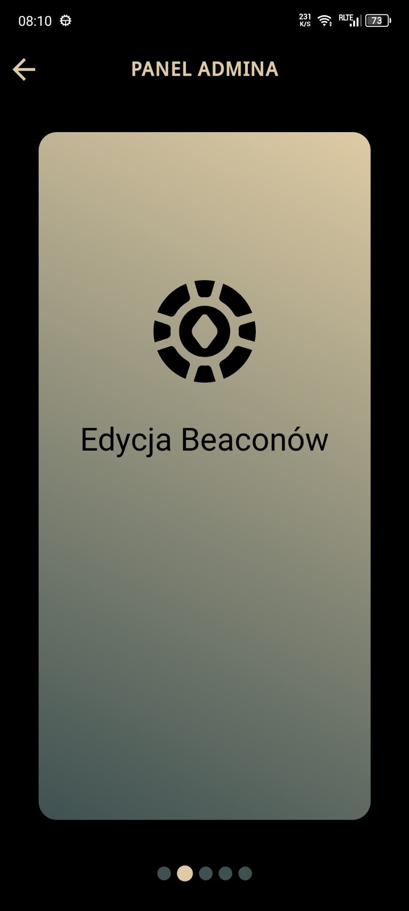
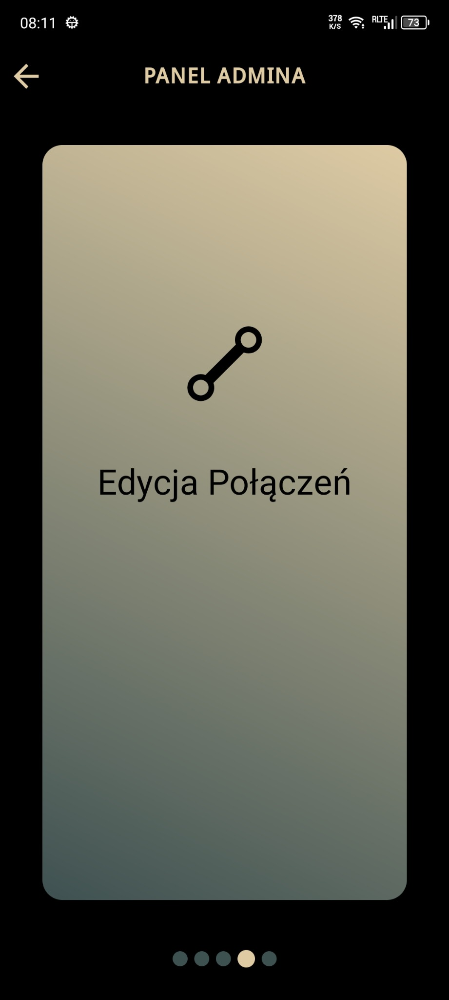
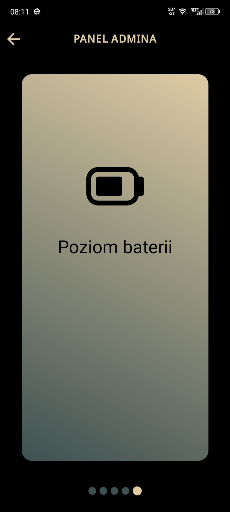
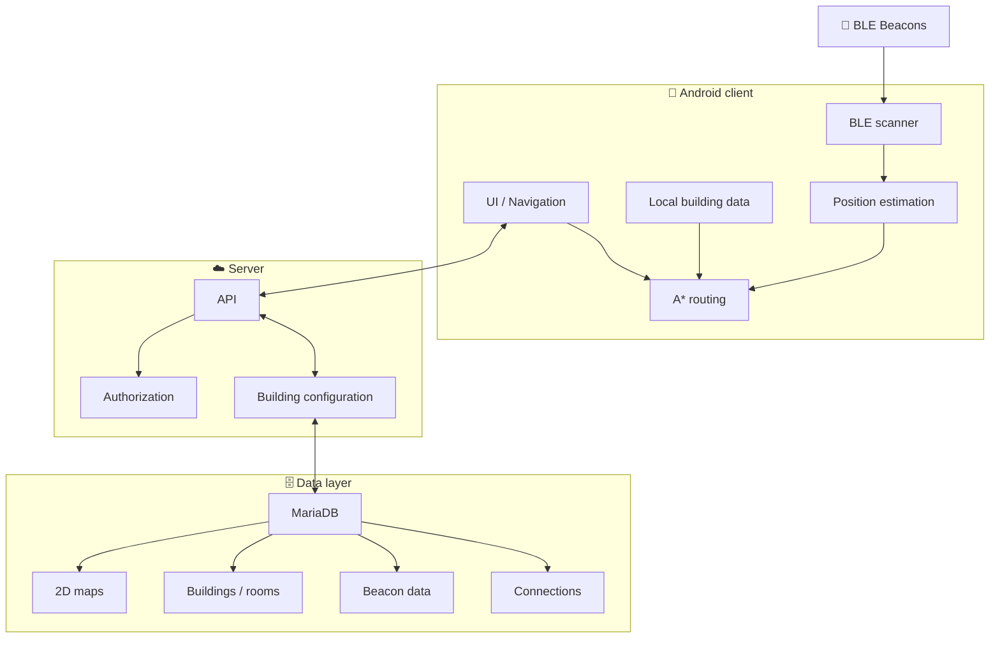

<div align="center">


# Navigo

### Indoor navigation system powered by Bluetooth Low Energy

**Navigo** is a mobile indoor-navigation system designed to help users find rooms and move through complex buildings using **BLE beacons, real-time positioning and dynamic route calculation**.

> **From “Where am I?” → to “Take me there.”**

[](https://developer.android.com/)
[](https://kotlinlang.org/)
[](https://nodejs.org/)
[](https://mariadb.org/)
[](https://www.bluetooth.com/)

**📍 Indoor positioning · 🗺️ Dynamic navigation · 🛰️ BLE beacons · 🛠️ Admin panel · 🔐 Privacy**

</div>

---

## ✨ What is Navigo?

Navigo solves a simple but surprisingly difficult problem:

> **How do you quickly find a specific room inside a large building when GPS is no longer useful?**

The system automatically detects the building using nearby **Bluetooth Low Energy beacons**, loads its digital map and configuration, estimates the user's position from beacon signals, and calculates a route to the selected destination.

The user does not have to manually select the building.

### 🎯 The goal

Navigo was designed around three principles:

- **Simple** — minimal number of actions required from the user.
- **Useful** — clear navigation inside complex, multi-floor buildings.
- **Scalable** — the same system can support multiple buildings and institutions.

The concept is particularly suited to places such as universities, hospitals, offices, public institutions, shopping centres, hotels and other large indoor spaces.

---

## 🎬 How it works



### In one sentence

**Beacon signals → position → destination → A* route → live navigation → automatic rerouting.**

---

# 🖼️ Product preview

The following screenshots show the real Navigo application UI and selected administrative workflows.

<div align="center">

<table>
<tr>
<td align="center"></td>
<td align="center"></td>
<td align="center"></td>
</tr>
<tr>
<td align="center"><b>Authentication & guest access</b></td>
<td align="center"><b>Automatic building discovery</b></td>
<td align="center"><b>2D indoor navigation</b></td>
</tr>
</table>

</div>

---

## 📱 Mobile experience

Navigo is designed as a focused Android application: the interface keeps the visual language consistent across authentication, Bluetooth status, building discovery and navigation.

<table>
<tr>
<td align="center"></td>
<td align="center"></td>
<td align="center"></td>
<td align="center"></td>
</tr>
</table>

---

## 🛠️ Administration

The application includes a dedicated administration layer for maintaining the indoor-navigation data.

<table>
<tr>
<td align="center"></td>
<td align="center"></td>
<td align="center"></td>
<td align="center"></td>
</tr>
</table>

### Beacon monitoring & graph configuration

<table>
<tr>
<td align="center"></td>
<td align="center"></td>
<td align="center"></td>
</tr>
</table>

> The screenshots are intentionally part of the repository documentation — they make the project immediately understandable without having to read the implementation first.

---

# 🚀 Key features

## 🏢 Automatic building detection

Navigo listens for BLE beacons in the user's surroundings.

Each building is associated with its own group of beacon identifiers. Once the application detects the expected identifiers, it can automatically identify the building and load its configuration.

**No manual building selection required.**

---

## 📍 Indoor positioning

The application continuously receives beacon signals and analyses:

- beacon identifier,
- RSSI signal strength,
- number of detected beacons,
- known beacon positions.

This information is used to estimate the user's position in the building and continuously update it while moving.

> Indoor positioning is based on BLE signal data rather than GPS.

---

## 🧠 Route calculation with A*

The navigation module uses a modified **A\*** pathfinding approach designed to operate across multiple floors.

The calculated route takes into account:

- corridors,
- connections between communication points,
- the selected destination,
- the user's current position,
- changes in the user's position.

If the user leaves the planned path, Navigo can calculate a new route from the current position.

```text
Current position
       │
       ▼
   [Position]
       │
       ▼
  ┌───────────┐
  │    A*     │
  │ pathfinder│
  └─────┬─────┘
        │
        ▼
   [Route nodes]
        │
        ▼
  🗺️ Navigation
```

---

## 🗺️ 2D & 3D navigation

The system provides two visual navigation modes.

### 2D

A clean representation of the building map with:

- current position,
- route,
- destination.

### 3D

A more spatial representation intended to make navigation easier to understand, especially for users who may find a traditional 2D map difficult to interpret.

The mode can be switched directly from the navigation interface.

---

## 🔎 Room search

Instead of browsing a potentially long list manually, users can search for a specific room by name.

This becomes particularly useful in large buildings with many destinations.

---

## 🔄 Real-time rerouting

Navigo does not treat the route as static.

During navigation the system repeatedly:

1. receives beacon data,
2. estimates the current position,
3. compares it with the current route,
4. updates navigation,
5. recalculates the route when necessary.

This makes the navigation resistant to normal user mistakes.

---

## 🛠️ Administration panel

Navigo includes a dedicated administration layer for managing building infrastructure.

Administrators can manage:

| Module | Capabilities |
|---|---|
| 📡 Beacons | Edit beacon data and configuration |
| 🏢 Institution | Edit institution name, short name and logo |
| 🚪 Rooms | Edit rooms and associated beacon IDs |
| 🔋 Battery monitoring | Track the current battery level of beacons |
| 🔗 Connections | Manage connections between floors / building zones |

This turns the system from a simple navigation application into a configurable platform.

---

## 🔋 Beacon maintenance

The application can collect beacon battery information when beacon signals are received and send the data to the database.

The administrator can therefore monitor the infrastructure and identify devices that require maintenance.

This is especially useful for larger deployments where manually checking every beacon would be inefficient.

---

# 🏗️ Architecture

Navigo is divided into several cooperating layers.



### Separation of responsibilities

| Layer | Responsibility |
|---|---|
| **Android / Kotlin** | BLE scanning, positioning, navigation UI, route calculation and communication |
| **Bluetooth LE** | Communication with physical beacon infrastructure |
| **Node.js / JavaScript** | API, configuration management and server-side communication |
| **MariaDB** | Buildings, maps, rooms, beacon locations and navigation data |
| **Admin layer** | Management and maintenance of the deployed infrastructure |

---

# 🧰 Technology stack

### Mobile

**Kotlin**

Used for the Android application and its core functionality:

- BLE scanning,
- beacon signal analysis,
- building detection,
- position estimation,
- route calculation,
- map visualization,
- communication with the server.

### Backend

**JavaScript + Node.js**

Responsible for:

- serving building maps,
- handling requests from the mobile application,
- managing database communication,
- updating configuration,
- supporting multiple buildings.

### Database

**MariaDB**

Stores:

- buildings,
- rooms and coordinates,
- beacon identifiers and locations,
- connections between navigation points,
- digital building maps.

### Localization

**Bluetooth Low Energy**

BLE was selected because it provides:

- low energy consumption,
- broadcast communication,
- simultaneous detection of multiple beacons,
- suitability for indoor environments,
- no requirement for traditional device pairing.

---

# 📡 BLE positioning pipeline

The localization process can be represented as:

```text
📡 Beacon A ─┐
📡 Beacon B ─┼──► 📱 Smartphone
📡 Beacon C ─┘          │
                        ▼
                     RSSI data
                        │
                        ▼
                Signal processing
                        │
                        ▼
                 Position estimate
                        │
                        ▼
                   🗺️ Map position
                        │
                        ▼
                   🧠 A* routing
                        │
                        ▼
                  Navigation UI
```

### Beacon configuration

According to the project documentation, the system uses:

| Parameter | Project configuration |
|---|---|
| Technology | Bluetooth Low Energy |
| Frequency | 2.4 GHz |
| Beacon interval | 1000 ms |
| Indoor range | up to ~15 m in the described configuration |
| Estimated localization accuracy | ~2–10 m depending on environment |
| Battery | CR2032 |
| Expected battery lifetime | dependent on transmit power and interval |

> Real-world BLE performance depends heavily on walls, metal structures, interference, beacon density and transmit power.

---

# 🗺️ Building maps

Navigo uses 2D building maps as the foundation for positioning and routing.

The documentation describes two possible ways of preparing them:

### 1. Existing architectural plans

Existing 2D plans can be:

- converted into a suitable digital format,
- simplified into a navigation-oriented map.

### 2. Laser-based mapping

A building can also be scanned using a laser sensor:

```text
🏢 Physical space
      │
      ▼
🔦 Laser scan
      │
      ▼
☁️ Point cloud
      │
      ▼
🗺️ Simplified 2D map
      │
      ▼
📱 Navigo
```

This allows the system to be introduced even when conventional architectural documentation is unavailable.

---

# 🔐 Security & privacy

Privacy is an important part of the architecture.

The project documentation describes:

- encrypted communication between the application and server,
- no requirement to provide personal data for basic navigation,
- no storage of the user's movement history on the server,
- use of anonymous device identifiers where required,
- possibility of storing building data on an institution's own server,
- explicit user control over remote assistance features.

### Remote assistance

If the user needs help, Navigo can connect them with a trusted person.

After the connection is accepted, the system can support:

- 📱 screen sharing,
- 📷 camera transmission,
- 🎙️ microphone audio,
- 🗣️ voice communication.

The feature is explicitly user-initiated and can be terminated by the user.

---

# 🌓 Personalization

Navigo is not tied to one visual identity.

The system supports building-specific customization such as:

- interface colours,
- navigation route colours,
- map background,
- institution logo,
- icons and room markers.

This allows one application to serve multiple organizations while maintaining their individual visual identity.

The application can also automatically adapt to the system theme:

- ☀️ Light mode
- 🌙 Dark mode

---

# 📦 Offline capability

Building configuration can be stored locally on the mobile device.

This allows the application to continue operating using previously downloaded building data when the internet connection is temporarily unavailable.

The server remains responsible for delivering and updating configuration, while the local cache improves resilience and responsiveness.

---

# 💡 What makes the project interesting?

Navigo is more than a map application.

The project combines several areas of software engineering:

### 📱 Mobile development

Native Android application written in Kotlin.

### 📡 Hardware communication

Real-world BLE beacon infrastructure and signal processing.

### 📐 Algorithms

Position estimation and graph-based route calculation using A*.

### ☁️ Backend engineering

API layer separating the mobile client from the data layer.

### 🗄️ Data modelling

Relational representation of buildings, rooms, beacons and navigation connections.

### 🧩 System architecture

A modular solution capable of supporting multiple buildings.

### 🛠️ Infrastructure management

Administration tools for maintaining deployed beacon infrastructure.

### 🔐 Security & privacy

Encrypted communication and minimizing the amount of personal information required by the system.

---

# 📊 Why BLE instead of GPS?

GPS works extremely well outdoors, but indoor environments create a different problem.

Navigo therefore uses local BLE infrastructure.

| Technology | Indoor navigation | Infrastructure | Accuracy potential | Privacy impact |
|---|---:|---:|---:|---:|
| GPS | ❌ | Low | Low indoors | Medium |
| Wi-Fi positioning | 🟡 | Existing network | Medium | Medium |
| UWB | ✅ | Higher | Very high | Medium |
| RFID / NFC | 🟡 | Tags/readers | Point-based | Low |
| Camera systems | ✅ | High | High | Higher |
| **BLE beacons** | **✅** | **Low** | **Good for the use case** | **Low** |

BLE provides a practical compromise between deployment cost, device compatibility, energy consumption and indoor positioning capabilities.

---

# 📈 Scalability

The architecture is designed with multiple buildings in mind.

A deployment can evolve from:

```text
1 building
   │
   ▼
1 floor
   │
   ▼
multiple floors
   │
   ▼
multiple buildings
   │
   ▼
🏢 Campus / organization
```

The same application can load different building configurations and visual identities depending on the detected environment.

The documentation also describes the possibility of hosting building data on the institution's own infrastructure.

---

# 🧪 Example user flow

```text
1. Open the application
        ↓
2. Bluetooth scan starts
        ↓
3. Navigo detects nearby beacons
        ↓
4. Building is identified automatically
        ↓
5. Building data is loaded
        ↓
6. User searches for a room
        ↓
7. Destination is selected
        ↓
8. A* calculates the route
        ↓
9. User follows the route in 2D / 3D
        ↓
10. Position is updated in real time
        ↓
11. Route is recalculated if necessary
        ↓
12. Destination detected
        ↓
13. ✅ Navigation completed
```

---

# 🛣️ Possible future development

The project documentation identifies several possible directions:

- 🍎 iOS version,
- 🔔 organizational notifications,
- 🔗 integration with room reservation systems,
- 🔐 integration with access-control systems,
- 🏢 integration with internal information systems,
- 📊 anonymous statistical analysis,
- 📈 optimization of beacon placement,
- 🏷️ expanded white-label personalization.

---

# 📁 Suggested repository structure

A clean repository could follow a structure similar to:

```text
Navigo/
├── 📱 android/
│   ├── app/
│   ├── navigation/
│   ├── bluetooth/
│   ├── positioning/
│   └── ui/
│
├── ☁️ server/
│   ├── api/
│   ├── controllers/
│   ├── services/
│   └── database/
│
├── 🗺️ maps/
│   └── buildings/
│
├── 🖼️ docs/
│   ├── screenshots/
│   ├── architecture/
│   └── diagrams/
│
└── README.md
```

> Adapt this structure to the actual repository. The section is intentionally presented as a suggested organization rather than a claim about the current source tree.

---

# 🧑‍💻 Engineering highlights

If you are evaluating this project from a software-engineering perspective, the most important parts are:

```text
                NAVIGO
                  │
       ┌──────────┼──────────┐
       ▼          ▼          ▼
   Mobile       Backend    Database
       │          │          │
       ▼          ▼          ▼
      BLE        API       MariaDB
       │
       ▼
   RSSI data
       │
       ▼
 Position estimation
       │
       ▼
   A* routing
       │
       ▼
  Real-time UI
       │
       ▼
  User experience
```

The interesting aspect of the project is the interaction between **software, algorithms and physical infrastructure** rather than any single technology in isolation.

---

# 📚 Documentation

The project is accompanied by technical documentation covering:

- system architecture,
- scanning and building detection,
- technology stack,
- BLE beacons,
- route calculation,
- navigation visualization,
- additional features,
- security and privacy,
- beacon maintenance,
- innovation and alternatives,
- commercialization possibilities,
- application usage,
- administration panel.

The original documentation also describes the application flow and example interfaces in detail.

---

# 👥 Project

**Navigo** was created as a practical indoor-navigation solution focused on usability, accessibility and scalable deployment.

The project demonstrates work across:

**Android • Kotlin • Bluetooth LE • RSSI • Algorithms • A* • Node.js • JavaScript • MariaDB • API design • UI/UX • System architecture**

---

<div align="center">

## 🧭 Navigo

### Find the room. Follow the route. Get there.

<br/>

**Built with Kotlin, BLE, Node.js and MariaDB.**

<br/>

⭐ If you find the project interesting, consider giving it a star.

</div>
